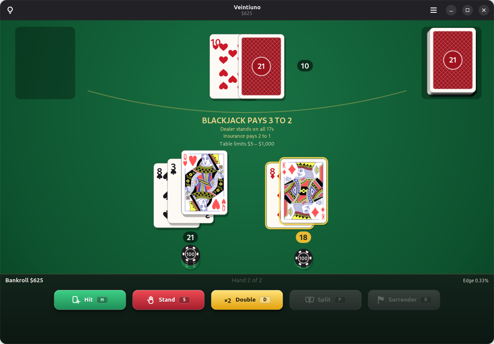

# Veintiuno

A complete casino blackjack table for Linux, built with GTK 4 and libadwaita.

*Una mesa de blackjack de casino completa para Linux. Interfaz en inglés y español.*



## Features

- **Every casino play:** hit, stand, double down, split (up to four hands, with optional
  resplitting and hitting split aces), late surrender, insurance and even money.
- **Configurable rules:** 1–8 decks, shoe penetration, dealer hits or stands on soft 17,
  3:2 or 6:5 blackjack, doubling restrictions, double after split, European
  no-hole-card game, table limits. Includes presets (Las Vegas Strip, Atlantic City,
  Downtown single deck, European) and a live house-edge estimate.
- **Training:** a strategy coach that tells you when a play differs from basic strategy
  (adjusted to the current rules), on-demand hints and a Hi-Lo running/true count display.
- **Statistics:** results, money won and lost, streaks, doubles, splits, insurance, and your
  basic-strategy accuracy. Your bankroll and stats are saved between sessions.
- **Polished table:** traditional English-pattern court cards, vector-drawn pips and chips,
  your own uploaded card backs, animated casino buttons, smooth dealing and flip animations,
  synthesized sound effects (`build-aux/gen-sounds.py`), an
  adaptive layout that works from phone-sized windows up, light and dark styles.
- **Keyboard control:** <kbd>1</kbd>–<kbd>6</kbd> chips, <kbd>Enter</kbd> deal,
  <kbd>H</kbd> hit, <kbd>S</kbd> stand, <kbd>D</kbd> double, <kbd>P</kbd> split,
  <kbd>R</kbd> surrender, <kbd>Y</kbd>/<kbd>N</kbd> insurance, <kbd>?</kbd> hint.

No real money is involved; chips are for fun and practice only.

## Install

### From the Veintiuno Flatpak repository (recommended)

Open <https://h4ck70r.github.io/veintiuno/> and click **Instalar Veintiuno**, or run:

```sh
flatpak install --user https://h4ck70r.github.io/veintiuno/io.github.H4ck70r.Veintiuno.flatpakref
```

The repository is GPG-signed. Once it is added, Veintiuno shows up in GNOME Software, the Linux
Mint Software Manager and KDE Discover, and updates together with your other apps.

### Flatpak bundle

Download the `.flatpak` file from the
[latest release](https://github.com/H4ck70r/veintiuno/releases/latest) and open it with
your software center, or run:

```sh
flatpak install --user Veintiuno-*.flatpak
```

The GNOME runtime is fetched from Flathub automatically.

### Flatpak from source

```sh
flatpak install --user flathub org.flatpak.Builder
flatpak run org.flatpak.Builder --user --install --force-clean build-dir io.github.H4ck70r.Veintiuno.json
flatpak run io.github.H4ck70r.Veintiuno
```

It then shows up in your applications menu as **Veintiuno**.

### From source with Meson

Dependencies: Python ≥ 3.10, PyGObject, GTK ≥ 4.14, libadwaita ≥ 1.5, Meson, gettext.
On Debian/Ubuntu/Linux Mint:

```sh
sudo apt install python3-gi python3-gi-cairo gir1.2-gtk-4.0 gir1.2-adw-1 gir1.2-rsvg-2.0 meson gettext desktop-file-utils appstream
meson setup _build --prefix=/usr/local
meson compile -C _build
meson test -C _build
sudo meson install -C _build
```

## Development

Run straight from the checkout inside the GNOME runtime (no install, no system packages):

```sh
build-aux/dev-run.sh
```

Or, with GTK 4 and libadwaita installed on the system: `cd src && python3 -m veintiuno`.

Run the engine tests with `python3 -m unittest discover -s tests`.

Project layout:

| Path | What |
| --- | --- |
| `src/veintiuno/engine/` | Pure-Python game engine: cards, shoe, rules, table state machine, basic strategy, Hi-Lo counter. No GTK. |
| `src/veintiuno/ui/` | GTK interface: the animated table (`table.py`), card art (`cardart.py`), window, dialogs. |
| `src/veintiuno/storage.py` | Saves bankroll, rules, preferences and stats as JSON in the user data directory. |
| `src/veintiuno/devtools.py` | Scripted screenshots (`VEINTIUNO_SCREENSHOT`, `VEINTIUNO_SCRIPT`), used for the store images. |
| `po/` | Translations. |
| `data/` | Desktop entry, AppStream metadata, icons, screenshots. |

### Releasing

1. Bump the version in `meson.build`, `src/veintiuno/main.py` and the metainfo `<releases>`.
2. Commit, tag `vX.Y.Z`, push, and create the GitHub release.
3. Run `build-aux/publish-flatpak-repo.sh` to build, sign and publish the Flatpak repository
   (gh-pages branch). It needs the "Veintiuno Flatpak Repository" GPG key.

### Translations

Regenerate the template and update a language:

```sh
xgettext --from-code=UTF-8 --add-comments=Translators -k_ -o po/veintiuno.pot -f po/POTFILES.in
msgmerge -U po/es.po po/veintiuno.pot
```

To add a language, copy the template to `po/<lang>.po`, translate it, and add the code to
`po/LINGUAS`.

## Publishing on Flathub

Flathub's [requirements](https://docs.flathub.org/docs/for-app-authors/requirements) apply
before submitting: a sustained development history, disclosure of any AI-generated material
in the app, a Flathub manifest written without AI assistance, and a submission pull request
opened by a person (against the `new-pr` branch of
[flathub/flathub](https://github.com/flathub/flathub)), not by an AI tool.

## Credits

Court card artwork (jacks, queens, kings): English pattern cards by Dmitry Fomin, CC0 1.0 —
see [`src/veintiuno/cards/README.md`](src/veintiuno/cards/README.md).

The sixteen bundled card backs (`src/veintiuno/backs/`) were designed by Hector "H4CK70R" Mejia
in CorelDRAW and are released under the same license as the game.

## License

GPL-3.0-or-later. See [COPYING](COPYING).
